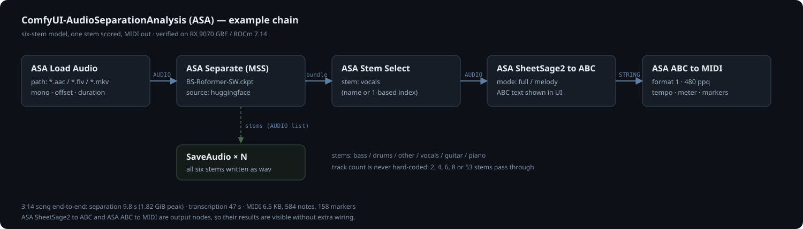

# ComfyUI-AudioSeparationAnalysis (ASA)

English: [README.en.md](README.en.md)

音频分离与分析节点：**任意 MSS 模型分离 → 按名字取轨 → SheetSage2 扒谱 → 导出 MIDI**。
节点保持原子化：一个节点只做一件事，批处理和文件夹交给 ComfyUI 自己的 list/batch 机制。

在 **AMD RX 9070 GRE / ROCm 7.14 / torch 2.12.0** 上实测可用（下表所有数字都在这张卡上跑出来）。
名字里不写 AMD，但分离走 `pymss`（MSS 模型库）、扒谱走 ComfyUI 自带的 SheetSage2，两边都只依赖
`torch.cuda`（ROCm 下就是 HIP），没有 NVIDIA 专属代码路径。

## 节点

| 节点 | 输入 → 输出 | 说明 |
|---|---|---|
| `ASA Load Audio` | path、sample_rate、mono、offset、duration → AUDIO、info | 走 pymss/av 解码，`.aac/.flv/.mkv` 这类核心 `LoadAudio` 吃不下的格式也能进；相对路径按 ComfyUI `input/` 解析 |
| `ASA Separate (MSS)` | audio、model、device、source、only_stems、use_tta、batch_size → stems、names、bundle、sample_rate | **不写死轨数**：1/2/4/6/8 轨、降噪、去混响、去和声都走这一个节点 |
| `ASA Stem Select` | bundle、stem → audio、name | 按名字（大小写不敏感，支持子串）或 1 起序号取轨 |
| `ASA SheetSage2 to ABC` | audio、model_name、mode → abc | 只出 ABC 文本，存盘不归它管 |
| `ASA ABC to MIDI` | abc、filename_prefix、save → saved_midi、bytes | 写成 Standard MIDI File（format 1、480 tick/拍，含 tempo/拍号/和弦与段落 marker） |
| `ASA Model Info` | model → info | 查模型架构、类别、预期轨名、体积 |
| `ASA Convert Model` | sheetsage2_dir、base_model_dir、output_name、dtype → status | 把 HF adapter + MERT-v2 合并成 ComfyUI 的音频编码器文件 |

`stems` 是 `AUDIO` 列表（原生 batching，可直接喂 `SaveAudio` 一起存），`bundle` 是给 `ASA Stem Select`
用的字典；`names` 是同一批轨名的字符串列表。

典型链路：

```
ASA Load Audio → ASA Separate (MSS) → ASA Stem Select("vocals") → ASA SheetSage2 to ABC → ASA ABC to MIDI
                     └→ stems ─→ SaveAudio ×N（存四轨/六轨 wav）
```



文件夹批处理不在节点里，用命令行（不占队列）：

```bash
python custom_nodes/ComfyUI-AudioSeparationAnalysis/cli.py \
  --folder E:/JiJiDown/Download --out output/asa \
  --model "htdemucs/six_stem · HTDemucs4_6stems.th" --stems vocals,other --limit 1
```

## 模型覆盖（pymss 目录，326 个可用条目）

| 族 | 条目数 | 常见轨数 | 用途 |
|---|---|---|---|
| `mel_band_roformer` | 143 | 2 / 4 | 人声/伴奏、去混响(9)、去回声(3)、去串音(8)、四轨(13) |
| `bs_roformer` | 93 | 2 / 4 / 6 / 53 | 高质量人声、6 轨、53 轨细分、鼓/弦乐/人声性别 |
| `vr`（VR arch = UVR5） | 29 | 2 | UVR5 经典分离：`vr_denoise`、`vr_dereverb`、`vr_deecho`、`vr_deecho_dereverb`、`vr_karaoke`、`vr_mgm` 等 |
| `htdemucs` | 8 | 4 / 6 | 快、稳：`HTDemucs4.th`（4 轨）、`HTDemucs4_6stems.th`（6 轨） |
| `scnet` | 13 | 4 | 轻量四轨、合唱四部、鼓/贝斯/钢琴 |
| `mdx23c` | 7 | 2 / 6 | 人声/伴奏、鼓六件、去混响 |
| `bandit` / `apollo` / `tasnet` / `legacy` | 23 | 2 / 3 / 4 | 语音/音乐/音效、音频修复、老模型 |

关于轨数：

- **6 轨**：`bs_roformer/six_stem · BS-Roformer-SW.ckpt`、`htdemucs/six_stem · HTDemucs4_6stems.th`、
  `bs_roformer/six_stem · logic_bs_roformer.ckpt`（轨名 drums/bass/other/vocals/guitar/piano）。
- **2 轨**：`bs_roformer/vocal_instrumental_dual`、`vr/vr_vocal_extraction`、`mel_band_roformer/vocal_instrumental_dual` 等。
- **8 轨**：pymss 目录里**没有**注册的 8 轨模型，所以节点不假设轨数——`ASA Separate` 直接返回模型给多少轨就是多少轨。
  自备 8 轨 checkpoint 时用 pymss 的 `pymss register`（或 `pymss.model_registry.register_model`）注册成用户模型，
  它会出现在 `model` 下拉里（标签带 `(user)`），8 个轨名原样透出。`mega_53_stems` 那种 53 轨模型同理。
- 降噪/去和声混响：`vr/vr_denoise · UVR-DeNoise-Lite.pth`、`vr/vr_deecho_dereverb · UVR-DeEcho-DeReverb.pth`、
  `mel_band_roformer/dereverb_deecho`（一次去掉混响+回声）、`mel_band_roformer/noise_bleed_control`（去串音）。

## AMD 实测（RX 9070 GRE 12 GiB，20 s 音频）

| 模型 | 轨数 | 加载 | 首次 | 热态 | 峰值显存 | 输出轨名 |
|---|---|---|---|---|---|---|
| `HTDemucs4_6stems.th` | 6 | 1.0 s | 3.6 s | 1.6 s | 0.79 GiB | drums/bass/other/vocals/guitar/piano |
| `UVR-DeNoise-Lite.pth` | 2 | 1.0 s | 1.3 s | 0.7 s | 1.04 GiB | Noise / No Noise |
| `UVR-DeEcho-DeReverb.pth` | 2 | 1.2 s | 5.8 s | 3.2 s | 2.74 GiB | No Reverb / Reverb |
| `dereverb-echo_mel_band_roformer_sdr_10.0169.ckpt` | 2 | 1.9 s | 6.5 s | 8.1 s | 3.16 GiB | dry / No dry |
| `BS-Roformer-SW.ckpt` | 6 | 2.1 s | 3.3 s | 2.9 s | 2.22 GiB | bass/drums/other/vocals/guitar/piano |
| `BS-Roformer-Resurrection-Inst.ckpt` | 2 | 1.2 s | 6.7 s | 6.2 s | 2.36 GiB | other / vocals |

注意"首次"之后还有一段：模型**下载**时间不算在上表里（BS-Roformer-SW 667 MB，ModelScope 约 6.6 MB/s）。
第一次用某个模型时会联网拉权重，UI 里会看到 `pymss` 的下载进度条。

## 依赖

```bash
.venv\Scripts\python.exe -m pip install pymss          # 含 pymss-core，负责 MSS 模型库与分离推理
```

`pymss` **不是** ComfyUI 自带依赖，重建 venv 后要重新装。模型权重落在 `C:\Users\<user>\.cache\pymss\models\`
（也可用 `pymss` 的 `--model-dir` / `PYMSS_MODEL_DIR` 改位置）。`FFmpeg` 未装时 pymss 会警告，
但 `.aac/.mp3/.wav` 仍可经 av/soundfile 解码；要处理容器格式再装 FFmpeg。

扒谱还需要 `models/audio_encoders/` 下的 SheetSage2 合并权重（`sheetsage2_audio_encoder_bf16.safetensors`），
用 `ASA Convert Model` 生成：

- HF `m-a-p/SheetSage2` 只有 LoRA adapter，底座是 `m-a-p/MERT-v2-FullSong`；
  `scale = lora_alpha/lora_rank = 2.0`，`W += (lora_B @ lora_A) * scale`，再补
  `output_projection.weight = token_embedding.weight`（tied 权重必须 clone）。
- **bf16 转换的坑**：`MelFrontend` 的 `spectrogram.window`、`mel_scale.fb`、`mel_mean/mel_std` 是模型里的
  显式 fp32 缓冲区，转 bf16 会把梅尔谱毁掉（扒谱结果稳定变差但每次一致，很容易误判成"bf16 就这样"）。
  `converter.py` 用 `FP32_ONLY_PREFIXES = ("encoder.feature_extractor.",)` 保住它们；修好后 bf16 与 fp32
  输出的 `.abc`/`.mid` 逐字节相同。

## 从旧包迁移

旧包 `ComfyUI-AMD-Music2Score`（AMD 前缀、含一条龙的 `AMD Folder Music to ABC`）已停用为
`custom_nodes/ComfyUI-AMD-Music2Score.disabled`。它拆成了：

| 旧 | 新 |
|---|---|
| `AMDFolderMusicToABC` | 删掉（批处理改 `cli.py`，图内用 list/batch） |
| `AMDDemucsStems`（固定 4 轨） | `ASA Separate (MSS)` + `ASA Stem Select` |
| `AMDSheetSage2VocalToABC`（转写+存盘+MIDI 混在一起） | `ASA SheetSage2 to ABC` + `ASA ABC to MIDI` |
| `AMDSheetSage2ConvertModel` | `ASA Convert Model` |

旧工作流里的节点名不再存在，需要在画布里换成 ASA 节点。
